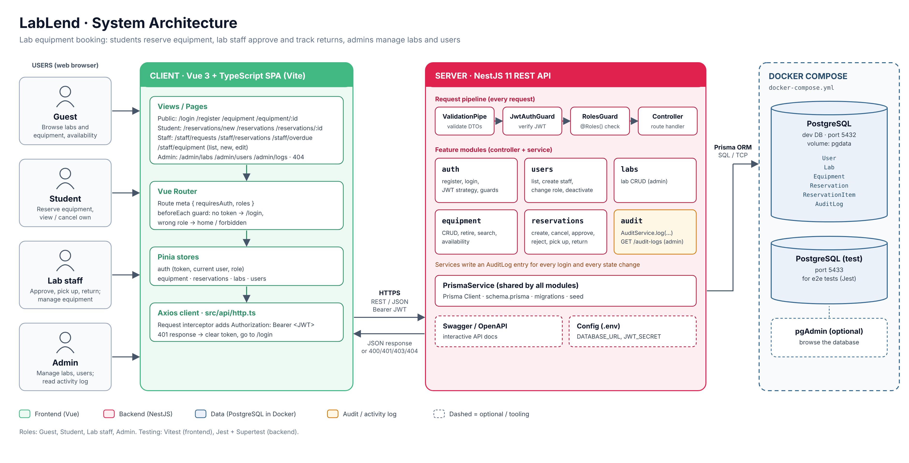

# SPEC (SRS): LoanlyLab, lab equipment booking
## 1. Purpose and scope

**Purpose.** LoanlyLab lets students reserve lab equipment for a time window, and lets
lab staff approve or reject those requests, hand the equipment out, and track
returns and overdue items. It replaces paper sign-out sheets in the faculty labs.

**In scope**
- Equipment catalogue grouped by lab, with search, filters and pagination
- Accounts with three roles: Student, Lab staff and Admin
- Reservations for one or more items over a time window, within available units
- Approval workflow: request, approve or reject, pick up, return
- Overdue tracking and return condition (OK or damaged)

**Out of scope**
- Payments or fines, email or SMS notifications, barcode hardware
- Booking the lab room itself, per-unit serial tracking (units are counted, not named)

**Users and roles**

| Role | Description | Can do |
| --- | --- | --- |
| Guest | Not logged in | Browse and search equipment and check availability; asked to log in or register when they try to reserve |
| Student | ITC student with an account | Browse equipment and availability, create and cancel own reservations, see own history |
| Lab staff | Lab technician or assistant | Everything a student can see, plus manage equipment, approve or reject requests, record pick-up and return, see all reservations and overdue items |
| Admin | Faculty lab manager | Everything lab staff can do, plus manage labs and user accounts: create staff accounts, change roles, deactivate users |

---

## 2. Functional requirements

Each requirement is a user story. Its acceptance criteria are in section 8 under the same ID.

| ID | Role | Story |
| --- | --- | --- |
| FR1 | Guest, Student, Staff | Browse and search equipment, 12 per page, filtered by lab, category and availability |
| FR2 | Guest | Register and log in, so I can reserve equipment |
| FR3 | Staff, Admin | Create and edit equipment, and retire equipment that is no longer lent out (broken, lost or replaced) |
| FR4 | Guest, Student | See how many units of an item are free for a chosen time window |
| FR5 | Student | Request a reservation of 1–5 units of one or more items for a time window, with a purpose |
| FR6 | Student | Cancel my reservation while it is pending or approved |
| FR7 | Staff, Admin | Approve or reject pending requests, with a reason when rejecting |
| FR8 | Staff, Admin | Record pick-up and return, with the condition of the equipment |
| FR9 | Student | See my reservations and their status, newest first |
| FR10 | Staff, Admin | See all reservations and an overdue list, filtered by status, lab and date |
| FR11 | Admin | Manage labs: create, edit, and delete labs that have no equipment |
| FR12 | Admin | Manage users: list and search users, create staff accounts, change a user's role, deactivate or reactivate an account, delete an account (soft delete) |
| FR13 | Admin | See an activity log of important actions, filtered by user, action and date |

---

## 3. Non-functional requirements

| ID | Category | Requirement |
| --- | --- | --- |
| NFR1 | Security | Passwords hashed with bcrypt (cost 10); `passwordHash` never in an API response |
| NFR2 | Security | JWT (1 h expiry) signed with `JWT_SECRET` from `.env`; protected routes on both frontend and backend |
| NFR3 | Security | Another student's reservation returns 404 (no IDOR); no secrets committed, `.env.example` complete |
| NFR4 | Integrity | Approving never lends more units than exist: the availability check and status change run in one Prisma transaction |
| NFR5 | Integrity | Status changes follow the state diagram in section 5; any other change returns 409 |
| NFR6 | Validation | Every create/update body validated with class-validator; global `ValidationPipe({ whitelist: true })`; 400 messages shown under the field in the UI |
| NFR7 | Performance | List endpoints paginated (max 50 per page); equipment list responds in under 500 ms with 1,000 seeded items on a laptop |
| NFR8 | Usability | Works on a 375 px phone screen; status shown with the same colour and label everywhere |
| NFR9 | Maintainability | TypeScript strict mode on both apps; `npm run build` passes with no type errors |
| NFR10 | Portability | Fresh clone to running app in under 10 minutes using the README; PostgreSQL via Docker Compose |
| NFR11 | Time | All times stored in UTC and shown in Asia/Phnom_Penh (UTC+7) |
| NFR12 | Auditability | Every action in the activity log list (section 5) writes one AuditLog row in the same transaction as the change; logs are read-only (no update or delete endpoint) and never store passwords, hashes or tokens |

---

## 4. System architecture
   

**Backend modules**

| Module | Responsibility |
| --- | --- |
| `auth` | Register, login, JWT strategy, `JwtAuthGuard`, `RolesGuard` |
| `users` | User list and search, create staff, change role, deactivate (admin); never returns `passwordHash` |
| `labs` | Lab CRUD (admin) |
| `equipment` | Equipment CRUD, retire, search and pagination, availability for a time window |
| `reservations` | Create, cancel, approve, reject, pick up, return; own list and staff list; overdue |
| `audit` | `AuditService.log(actor, action, entity, details)` called by the other services; `GET /audit-logs` for admins |
| `prisma` | `PrismaService` shared by all modules |

**Frontend pages**: `/login`, `/register`, `/equipment`, `/equipment/:id` (details + availability),
`/reservations/new`, `/reservations` (mine), `/reservations/:id`, `/staff/requests`,
`/staff/reservations`, `/staff/overdue`, `/staff/equipment`, `/staff/equipment/new`,
`/staff/equipment/:id/edit`, `/admin/labs`, `/admin/users`, `/admin/users/new`, `/admin/logs`, `/:pathMatch(.*)*` (404).

**Guard table**

| Endpoint | Guest | Student | Lab staff | Admin |
| --- | --- | --- | --- | --- |
| `POST /auth/register`, `POST /auth/login` | ✓ | ✓ | ✓ | ✓ |
| `GET /labs`, `GET /equipment`, `GET /equipment/:id`, `GET /equipment/:id/availability` | ✓ | ✓ | ✓ | ✓ |
| `POST/PATCH/DELETE /equipment` | 401 | 403 | ✓ | ✓ |
| `POST/PATCH/DELETE /labs` | 401 | 403 | 403 | ✓ |
| `POST /reservations` | 401 | ✓ | 403 | 403 |
| `GET /reservations` | 401 | own only | all | all |
| `GET /reservations/:id` | 401 | own only, else 404 | ✓ | ✓ |
| `POST /reservations/:id/cancel` | 401 | own only, else 404 | 403 | 403 |
| `POST /reservations/:id/approve`, `/reject`, `/pickup`, `/return` | 401 | 403 | ✓ | ✓ |
| `GET /reservations/overdue` | 401 | 403 | ✓ | ✓ |
| `GET /users`, `POST /users`, `PATCH /users/:id`, `DELETE /users/:id` | 401 | 403 | 403 | ✓ |
| `GET /audit-logs` | 401 | 403 | 403 | ✓ |

---

## 5. Data management

**Entities** (Prisma, PostgreSQL). Main CRUD entity: **Equipment**.

| Entity | Fields | Relations |
| --- | --- | --- |
| User | id, email (unique), name, studentId (nullable), passwordHash, role (`STUDENT`, `STAFF`, `ADMIN`), isActive, lastLoginAt (nullable), deletedAt (nullable, soft delete), createdAt, updatedAt | has many Reservations, many AuditLogs (as actor) |
| Lab | id, name (unique), building, room | has many Equipment |
| Equipment | id, labId, name, category, description, totalUnits, status (`ACTIVE`, `MAINTENANCE`, `RETIRED`), createdAt, updatedAt | belongs to Lab; has many ReservationItems |
| Reservation | id, studentId, startAt, endAt, purpose, status, rejectReason, pickedUpAt, returnedAt, returnCondition (`OK`, `DAMAGED`), returnNote, createdAt | belongs to User; has many ReservationItems |
| ReservationItem | id, reservationId, equipmentId, quantity | belongs to Reservation and Equipment |
| AuditLog | id, actorId (nullable), action, entityType (`USER`, `LAB`, `EQUIPMENT`, `RESERVATION`), entityId, details (JSON, e.g. old and new status), createdAt | belongs to User (actor) |

One-to-many relations: Lab → Equipment, User → Reservation, Reservation → ReservationItem, Equipment → ReservationItem, User → AuditLog.

**Reservation states**

```
PENDING ──approve──► APPROVED ──pickup──► CHECKED_OUT ──return──► RETURNED
   │                    │
   ├──reject──► REJECTED │
   └──cancel──► CANCELLED ◄──cancel──┘
```
A CHECKED_OUT reservation whose `endAt` has passed is shown as **Overdue** (computed, not stored).

**Rules**
- Units in use for a window = sum of `quantity` from APPROVED or CHECKED_OUT reservations whose window overlaps it (`startAt < otherEnd AND endAt > otherStart`).
- Free units = `totalUnits` − units in use. Equipment in MAINTENANCE or RETIRED has 0 free units.
- A window starts at least 1 hour from now, ends after it starts, and lasts at most 7 days.
- A student can have at most 3 active reservations (PENDING, APPROVED or CHECKED_OUT).
- Equipment that appears in any reservation cannot be deleted, only retired. Retired = no longer lent out (broken beyond repair, lost or replaced): it is hidden from the catalogue and cannot be reserved, but stays in the database so past reservations keep their history.
- A return marked DAMAGED moves that equipment to MAINTENANCE.
- Reservations are never deleted (history).
- **Deactivate vs delete.** `isActive = false` is a temporary block; the admin can reactivate. `deletedAt` set = the account is removed: hidden from user lists, cannot log in, cannot be reactivated from the UI, but its reservations and log entries stay. Users are never removed from the database.
- `lastLoginAt` is updated on every successful login.

**Activity log (AuditLog actions)**

| Area | Actions logged |
| --- | --- |
| Auth | `LOGIN`, `LOGIN_FAILED` (actor empty, email in details) |
| Users | `USER_CREATED`, `ROLE_CHANGED`, `USER_DEACTIVATED`, `USER_REACTIVATED`, `USER_DELETED` |
| Labs | `LAB_CREATED`, `LAB_UPDATED`, `LAB_DELETED` |
| Equipment | `EQUIPMENT_CREATED`, `EQUIPMENT_UPDATED`, `EQUIPMENT_RETIRED`, `EQUIPMENT_REACTIVATED` |
| Reservations | `RESERVATION_CREATED`, `_APPROVED`, `_REJECTED`, `_CANCELLED`, `_PICKED_UP`, `_RETURNED` |

**Seed data** (`npx prisma db seed`): 1 admin, 2 staff, 4 students (one deactivated, one deleted), 3 labs, 20 equipment items (some in maintenance, one retired), reservations in every status including one overdue.

**Environments**: `backend/.env` (dev DB on port 5432), `backend/.env.test` (test DB on port 5433), both from `.env.example`. Migrations committed in `backend/prisma/migrations`.

---

## 6. User documentation

| Document | Content | Due |
| --- | --- | --- |
| `README.md` | Purpose, screenshots, setup from a fresh clone (Docker Compose, migrate, seed, run both apps), environment variables, seeded accounts, test commands, project map | Check 4, final at Check 7 |
| `docs/API.md` | Every endpoint: method, path, body, success status, error statuses | Check 3 |
| `backend/requests.http` | One valid and one invalid request per endpoint | Check 3 |
| `docs/REVIEW.md` | Every Vue component and what it does | Check 2 |
| `docs/TEST_PLAN.md` | One test name per acceptance criterion | Check 6 |
| `docs/SECURITY_CHECKLIST.md` | Course security checklist filled for this app | Check 6 |
| `AI_LOG.md`, `DECISIONS.md`, `CHECK.md` | Kept up every check | Every check |

---

## 7. Testing requirements

| Level | Tool | Command | Minimum |
| --- | --- | --- | --- |
| Backend E2E/API | Jest + Supertest, separate test DB | `npm run test:e2e` (backend) | Key flows below, including a 401/403 case and an IDOR 404 case |
| Frontend component | Vitest + Vue Test Utils | `npm run test:unit` (frontend) | At least 2 tests of real behaviour (reservation form validation, status badge) |
| Manual | `requests.http` | — | Each endpoint, valid and invalid |
| CI | GitHub Actions | on every push | Build and both test suites green |

Key flows to cover end to end: register and log in, and a deleted user cannot log in (FR2, FR12); approving writes one audit entry (FR13); staff creates equipment (FR3);
request within and beyond free units (FR5); the 4th active reservation is refused (FR5);
approve, pick up, return as damaged (FR7, FR8); approving when units ran out returns 409 (NFR4);
an invalid state change returns 409 (NFR5); another student's reservation returns 404 (NFR3);
a student calling an approve endpoint gets 403.

---

## 8. Acceptance criteria

Each story is marked **Done** or **Not done** at Check 7.

**FR1 · Browse equipment** — Not done
- `/equipment` shows 12 items per page, sorted by name, with lab, category, total units and status.
- Search matches name or category, case-insensitive; filters by lab and category combine with search.
- Guests see the same list as students, without logging in.
- Retired items are hidden from guests and students; items in maintenance show "Under maintenance" and cannot be reserved.
- A guest who clicks "Reserve" is sent to `/login` (with a link to register) and comes back to the reservation form after logging in.

**FR2 · Register and log in** — Not done
- Register needs a valid email, a name (2–50 chars), a student ID matching `e20XXXXX`, and a password of at least 8 characters; each error shows under its field.
- An email already in use returns 409 "Email already in use".
- Wrong email or password returns 401 "Invalid email or password".
- Register always creates a STUDENT; a deactivated account gets 403 "Account is deactivated" at login.
- After login the user returns to the page they tried to open.

**FR3 · Manage equipment** — Not done
- Staff can retire an item; it disappears from the student catalogue but still shows in old reservations, and staff can reactivate it.
- Name 2–100 chars, category required, total units 1–100, lab must exist; otherwise 400 with field messages.
- Total units cannot go below the units currently approved or checked out: 409 "N units are currently reserved".
- Deleting equipment that has reservations returns 409 "Equipment has reservations; retire it instead".
- A student calling any equipment write endpoint gets 403.

**FR4 · Check availability** — Not done
- Choosing a start and end on `/equipment/:id` shows "N of M units free" for that window.
- An end before the start shows "End must be after start" and no request is sent.

**FR5 · Request a reservation** — Not done
- Quantity per item 1–5; purpose 10–300 chars; window rules from section 5; otherwise 400 with the matching message.
- More units than free returns 409 "Only N units of <name> are free for that time".
- A 4th active reservation returns 409 "You already have 3 active reservations".
- A new reservation has status PENDING and appears in the staff request list.

**FR6 · Cancel a reservation** — Not done
- A PENDING or APPROVED reservation of mine can be cancelled; its units become free again.
- Cancelling a CHECKED_OUT, RETURNED, REJECTED or CANCELLED reservation returns 409 "Cannot change reservation from X to CANCELLED".

**FR7 · Approve or reject** — Not done
- Approve re-checks free units; if they ran out, 409 "Not enough free units to approve" and the reservation stays PENDING.
- Reject requires a reason of 5–200 chars, which the student sees on the reservation.
- Approving or rejecting anything not PENDING returns 409.

**FR8 · Pick-up and return** — Not done
- Pick-up is allowed only for APPROVED reservations from 30 minutes before `startAt`; it sets `pickedUpAt`.
- Return is allowed only for CHECKED_OUT; it requires a condition and sets `returnedAt`.
- A DAMAGED return requires a note and moves the equipment to MAINTENANCE.

**FR9 · My reservations** — Not done
- `/reservations` lists only my reservations, newest first, 10 per page, filterable by status.
- Each row shows the items, window, status badge, and reject reason if any.
- `/reservations/:id` shows the reservation's history (who changed its status and when), taken from the activity log.
- Another student's reservation id returns 404.

**FR10 · Staff overview and overdue** — Not done
- `/staff/reservations` lists all reservations, 20 per page, filterable by status, lab and date range.
- `/staff/overdue` lists CHECKED_OUT reservations past `endAt`, most overdue first, with student name and hours late.

**FR11 · Manage labs (admin)** — Not done
- Lab name 2–50 chars and unique; a duplicate returns 409 "Lab name already exists".
- Deleting a lab that still has equipment returns 409 "Move or delete its equipment first".
- Lab staff calling any lab write endpoint get 403.

**FR12 · Manage users (admin)** — Not done
- `/admin/users` lists users, 20 per page, searchable by name or email and filterable by role.
- An admin can create a STAFF account (email, name, temporary password) and change any user's role.
- An admin cannot change their own role or deactivate themselves: 409 "You cannot change your own account".
- A deactivated user cannot log in; their past reservations stay visible to staff.
- Deleting a user sets `deletedAt`; the user disappears from `/admin/users`, cannot log in ("Invalid email or password"), and their reservations stay.
- An admin cannot delete their own account: 409 "You cannot change your own account".
- Lab staff and students calling any `/users` endpoint get 403.

**FR13 · Activity log (admin)** — Not done
- `/admin/logs` lists log entries newest first, 20 per page, filterable by user, action and date range.
- Each row shows time, user name (or "Unknown" for a failed login), action, and the item affected with a link to it.
- Approving a reservation creates exactly one `RESERVATION_APPROVED` entry with the old and new status in details.
- No endpoint can edit or delete a log entry; lab staff and students calling `/audit-logs` get 403.

---

## 9. Project timeline

| Check | Week | Milestone for LabLend |
| --- | --- | --- |
| Approval | 2 | Topic approved at Practice 1; repo `ip1-<student-id>` created from the template |
| 1 | 4 | This SPEC, wireframes, static Vue screens for equipment list, equipment detail, reservation form, my reservations, staff requests |
| 2 | 6 | Router (incl. `/equipment/:id` and 404), Pinia stores for equipment and reservations from mock data, reservation form with FR5 validation; approving on the staff page updates the student's list |
| 3 | 8 | NestJS modules in memory for labs, equipment, reservations; DTOs; 201/400/404/409; `API.md`; `requests.http` |
| 4 | 10 | Prisma schema and migrations, seed, availability query, Vue calls the real API, errors shown in the UI |
| 5 | 12 | Auth with Student, Staff and Admin roles, admin user management (deactivate, soft delete), activity log, guard table enforced, router guard, login page |
| 6 | 14 | E2E and unit tests, search + pagination (advanced feature), CI, security checklist |
| 7 | 16 | All stories marked, README final, Practice 7 story test-first, live change task |

Calendar dates of each practice session to be added once known.
